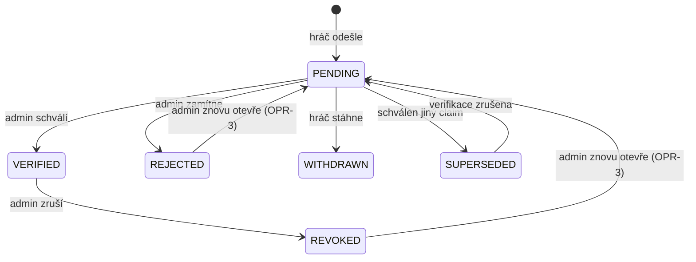
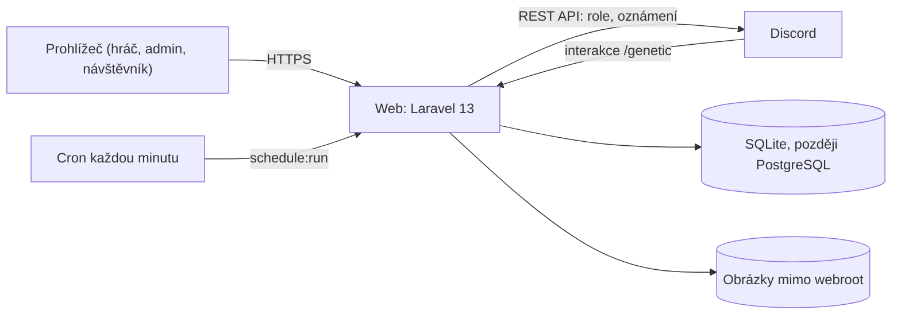

# Genetic Mastery – zadání a analýza

*Export zadání ke dni 14. 11. 2026. Původní dokument je v Claude Docs.*

## Shrnutí a doporučení

Doporučuji variantu A: jeden web v PHP (Laravel 13), který obslouží i Discord. Oznámení posílá přes Discord REST API a příkazy `/genetic` přijímá přes HTTP Interactions endpoint. Samostatný bot v Go proto v první verzi není potřeba.

Genetic Mastery eviduje 54 milestoneů (9 druhů × 6 statů, hodnota 250). Hráči k nim nahrávají důkazy, admin je ručně schvaluje a web z toho počítá společný progres clusteru a Indo Potential.

Klíčová rozhodnutí:

- **Milestone a submission jsou dvě entity.** Milestoneů je pevně 54, submissions k nim může být libovolně mnoho. Stav milestoneu se ze submissions odvozuje.

- **Progres a Indo Potential se neukládají.** Vždy se počítají z počtu ověřených milestoneů, takže je zrušení verifikace přepočítá samo.

- **Ověření jen jednou hlídá databáze.** Unikátní index nedovolí dvě ověřené submissions u jednoho milestoneu, ani když dva admini schvalují současně.

- **Hráče identifikuje Discord ID, ne jméno.** Historie přežije přejmenování i odchod ze serveru.

- **Důkazy leží mimo veřejný adresář webu.** Typ souboru se ověřuje podle obsahu a web zobrazuje přegenerovanou kopii bez metadat.

- **Discord je doplněk, ne závislost.** Když Discord nefunguje, schválení proběhne a oznámení odejde později.

Před začátkem vývoje je potřeba potvrdit otevřené otázky na konci dokumentu. U každé je navržená výchozí odpověď.

## Analýza požadavků

Jádro zadání je jasné a vzorec sedí se všemi příklady: 18 milestoneů dává 600, 23 dává 725 a 54 dává maximum 1500. Problémy jsou v datovém modelu a v situacích, které zadání nepopisuje (kap. = kapitola původního zadání).

| Téma                   | Co zadání neseřeší nebo co nesedí                                                                                                                                                            | Návrh                                                                                                                                                            |
|------------------------|----------------------------------------------------------------------------------------------------------------------------------------------------------------------------------------------|------------------------------------------------------------------------------------------------------------------------------------------------------------------|
| Milestone a submission | Kap. 1 dává milestoneu pole pokusu: hráče, datum odeslání, důkazy. Jeden milestone ale může mít víc pokusů.                                                                                  | Dvě entity: 54 milestoneů jako číselník a libovolně mnoho submissions. Stav milestoneu se odvozuje.                                                              |
| Stav REJECTED          | Zamítá se pokus, ne milestone. Ten po zamítnutí zůstává nesplněný.                                                                                                                           | REJECTED jen u submission. Milestone má stavy LOCKED, PENDING a VERIFIED.                                                                                        |
| Stav LOCKED            | Zadání ho nedefinuje.                                                                                                                                                                        | LOCKED = nikdo ho nesplnil a nic nečeká na schválení.                                                                                                            |
| Souběžné claimy        | Kap. 5 řeší jen stav po ověření. Není jasné, co když dva hráči pošlou claim dřív, než admin rozhodne.                                                                                        | Povolit. Admin vidí pořadí podle času odeslání, po schválení jednoho se ostatní uzavřou jako SUPERSEDED. Zákaz by dovolil milestone zablokovat falešným claimem. |
| Počítadlo progresu     | Kap. 4 „přidá +1“, kap. 8 „přepočítat“. Uložené počítadlo se při opravách rozejde s daty.                                                                                                    | Progres i Indo Potential vždy počítat z dat. Přepočet z kap. 8 pak odpadá.                                                                                       |
| Příkaz `/genetic`      | Příkaz s podpříkazy nejde v Discordu spustit samotný ([Discord docs](https://docs.discord.com/developers/interactions/application-commands)). `/genetic` vedle `/genetic progress` neprojde. | `/genetic overview`, `/genetic progress`, `/genetic leaderboard`.                                                                                                |
| Přílohy z Discordu     | Odkazy na přílohy mimo Discord expirují zhruba po 24 hodinách ([TechRadar](https://www.techradar.com/pro/security/discord-is-switching-to-temporary-links-to-stop-malware)).                 | Obrázky vždy ukládat u sebe. Ve variantě A se nahrávají přímo na web, takže se to týká jen variant B a C.                                                        |
| Změna jména            | Kap. 7 chce zachovat historii, neříká jak.                                                                                                                                                   | Klíčem je Discord ID. Submission si navíc uloží jméno v době odeslání.                                                                                           |
| Zrušení verifikace     | Kap. 8 neříká, co se stane se submission, s ostatními claimy a s oznámením na Discordu.                                                                                                      | Submission přejde do REVOKED a nemaže se. Uzavřené claimy se vrátí do PENDING. Zpráva na Discordu se upraví a odejde oprava.                                     |
| Admin jako hráč        | Admin může schválit vlastní claim.                                                                                                                                                           | Ve výchozím stavu zakázat. Nastavení povolí výjimku pro cluster s jediným adminem.                                                                               |
| Viditelnost důkazů     | Není jasné, kdo vidí screenshoty.                                                                                                                                                            | Čekající a zamítnuté důkazy vidí autor a admini. Ověřené žádosti včetně důkazů jsou veřejné (rozhodnuto 14. 11. 2026).                                           |
| Záznam změn            | Kap. 8 chce opravy, ale ne záznam, kdo co změnil.                                                                                                                                            | Audit log všech admin akcí, do kterého se jen přidává.                                                                                                           |

## Varianty technologií

Doporučená je varianta A, web v PHP: jako jediná pokryje všechny kapitoly zadání jednou aplikací a jedním nasazením. Bot v Go sám nestačí na hlavní stránku a dashboardy. Kombinace C přidává druhý jazyk a druhou službu bez nové funkce.

| Kritérium                                   | A: web v PHP                         | B: bot v Go                                                     | C: web v PHP + bot v Go            |
|---------------------------------------------|--------------------------------------|-----------------------------------------------------------------|------------------------------------|
| Hlavní stránka a dashboardy (kap. 2, 4, 11) | Ano                                  | Jen náhrada: zpráva s tabulkou, kterou bot průběžně upravuje    | Ano                                |
| Nahrání více obrázků (kap. 3, 10)           | Ano, s náhledy a lupou pro admina    | Přílohy v příkazu do 20 MB na soubor, bot je musí hned stáhnout | Ano                                |
| Admin opravy a historie (kap. 7, 8)         | Formuláře a filtry                   | Přes příkazy a tlačítka, nepřehledné                            | Ano                                |
| Oznámení na Discordu (kap. 6)               | Ano, přes REST API                   | Ano                                                             | Ano                                |
| Příkazy `/genetic` (kap. 6)                 | Ano, přes HTTP Interactions endpoint | Ano                                                             | Ano                                |
| Přihlášení (kap. 9)                         | Discord OAuth2                       | Odpadá, identitu dává Discord                                   | Discord OAuth2 na webu             |
| Co běží                                     | Web a plánovač (cron)                | Trvale běžící proces bota                                       | Web, cron a bot nad sdílenými daty |
| Hosting                                     | PHP hosting s HTTPS nebo VPS         | VPS nebo kontejner                                              | VPS                                |
| Náročnost první verze                       | Střední                              | Střední, ale s odchylkou od zadání                              | Vyšší                              |

**Varianta A zvládne Discord bez bota.** Discord posílá slash příkazy na veřejnou HTTPS adresu webu, ten ověří podpis a do 3 sekund odpoví ([Discord docs](https://docs.discord.com/developers/interactions/receiving-and-responding.md)). Dotaz na progres trvá milisekundy, takže limit nehrozí. Role uživatele web zjistí přes REST API bez privilegovaných intentů ([Discord docs](https://docs.discord.com/developers/gateway/you-might-not-need-a-privileged-intent)).

**Varianta B se hodí jen pro komunitu čistě v Discordu.** Hráč by posílal důkaz příkazem s přílohami a admin by schvaloval tlačítky v admin kanálu. Limit uploadu bez Nitra je od srpna 2026 20 MB na soubor ([Dexerto](https://www.dexerto.com/entertainment/discord-raises-free-upload-limit-to-20mb-after-lowering-it-two-years-ago-3398251/)). Odkazy na přílohy expirují, takže by bot musel obrázky stahovat a ukládat sám.

**Varianta C dává smysl, až bude potřeba něco, co HTTP neumí.** Například stav bota „Sleduje 23/54“, reakce na běžné zprávy v kanálu nebo události o členech. Bot pak čte data přes interní API webu, ne přímo z databáze; v Go se hodí knihovna disgo nebo discordgo.

## Cíl, rozsah a role

První verze musí umět tři věci: bezpečně přijmout důkazy, nechat admina ručně rozhodnout a správně spočítat progres clusteru (kap. 12). Vše ostatní je jim podřízené.

**V rozsahu první verze**

- Hlavní stránka s progresem, Indo Potential a tabulkou 54 milestoneů.

- Přihlášení přes Discord, dashboard hráče a odeslání submission s obrázky.

- Admin fronta, schválení, zamítnutí, opravy, historie a audit log.

- Oznámení nových milestoneů na Discordu a příkazy `/genetic`.

**Mimo rozsah**

- Automatická kontrola screenshotů (OCR, čtení ARK dat).

- Napojení na herní servery (RCON, pluginy, mody).

- Víc clusterů nebo sezón, viz otevřené otázky.

**Role**

| Role       | Kdo to je                                                     | Co smí                                                                                                             |
|------------|---------------------------------------------------------------|--------------------------------------------------------------------------------------------------------------------|
| Návštěvník | Kdokoli bez přihlášení                                        | Hlavní stránka s progresem, Indo Potential a tabulkou milestoneů a detail ověřených milestoneů včetně důkazů.      |
| Hráč       | Člen Discord serveru clusteru přihlášený přes Discord         | Navíc vlastní dashboard, odeslání a stažení vlastní submission a důkazy vlastních čekajících a zamítnutých claimů. |
| Admin      | Hráč s admin rolí na Discordu nebo s Discord ID v konfiguraci | Navíc fronta, schvalování, zamítání, opravy, audit log a originály důkazů.                                         |

**Předpoklady** (pokud neplatí, oprav je)

- Hodnota 250 znamená body ve statu (levely včetně mutací), ne zobrazenou hodnotu. Web ji jen zobrazuje, kontroluje ji admin.

- Druhy, staty a hodnota 250 se zakládají z konfigurace (seed), ne natvrdo v kódu.

- Jeden cluster, jeden Discord server, jedna sezóna.

- Přihlásit se jde jen přes Discord.

## Datový model, stavy a výpočty

Data stojí na dvou entitách: 54 milestoneů jako pevný číselník a submissions jako jednotlivé pokusy hráčů. Stav milestoneu, progres i Indo Potential se z nich vždy počítají.

**Kódy milestoneů** mají tvar `DRUH_STAT_HODNOTA`, například `GIGA_MELEE_250`.

- Druhy: `REX`, `RAPTOR`, `CARNO`, `GIGA`, `THERI`, `SPINO`, `ALLO`, `YUTY`, `MEGALO`.

- Staty: `HEALTH`, `STAMINA`, `OXYGEN`, `FOOD`, `WEIGHT`, `MELEE`.

**Tabulky**

| Tabulka             | Klíčové sloupce                                                                                                                                                                                                              | Účel                                                                 |
|---------------------|------------------------------------------------------------------------------------------------------------------------------------------------------------------------------------------------------------------------------|----------------------------------------------------------------------|
| `users`             | `discord_id` (unikátní, text), `username`, `display_name`, `avatar_hash`, `last_login_at`                                                                                                                                    | Hráči a admini. Jméno a avatar se obnoví při každém přihlášení.      |
| `milestones`        | `code` (unikátní), `dinosaur`, `stat`, `required_value`, `sort_order`                                                                                                                                                        | 54 řádků ze seedu, bez sloupce se stavem.                            |
| `submissions`       | `public_id`, `milestone_id`, `user_id`, `player_name_snapshot`, `status`, `player_note`, `submitted_at`, `reviewed_by`, `reviewed_at`, `rejection_reason`, `revoked_by`, `revoked_at`, `revoke_reason`, `discord_message_id` | Pokusy hráčů a rozhodnutí adminů. Nic se nemaže.                     |
| `submission_images` | `submission_id`, `storage_key`, `original_name`, `mime`, `bytes`, `width`, `height`, `sha256`, `position`                                                                                                                    | Důkazy k submission.                                                 |
| `submission_notes`  | `submission_id`, `author_id`, `visibility` (public / internal), `body`, `created_at`                                                                                                                                         | Poznámky adminů. Veřejné se ukazují v historii, interní jen adminům. |
| `audit_log`         | `actor_id`, `action`, `entity`, `entity_id`, `before`, `after`, `reason`, `created_at`                                                                                                                                       | Záznam každé admin akce, jen se přidává.                             |
| `discord_outbox`    | `kind`, `submission_id`, `payload`, `status`, `attempts`, `last_error`, `message_id`                                                                                                                                         | Fronta zpráv na Discord s opakováním.                                |

`public_id` je čitelné ID pro lidi, například `S-000123`.

**Stavy submission**

Zamítnutý ani zrušený claim se sám neotevírá: hráč pošle nový, nebo ho admin znovu otevře do PENDING (OPR-3). SUPERSEDED se do PENDING vrací automaticky, když admin zruší verifikaci, kvůli které byl uzavřen.

Odvozený stav milestoneu:

- **VERIFIED**, pokud má submission ve stavu VERIFIED. UI ukáže „VERIFIED – Discovered by Joe“.

- **PENDING**, pokud žádná není VERIFIED, ale aspoň jedna čeká.

- **LOCKED** ve všech ostatních případech.

**Výpočty**

**Indo Potential = 150 + 25 × V**, **progres = V / 54**

V je počet milestoneů se submission ve stavu VERIFIED. Při V = 54 vychází přesně 1500, zvláštní strop není potřeba. Hodnoty se neukládají, počítají se dotazem při každém zobrazení.

**Integritní pravidla v databázi**

- Unikátní částečný index `(milestone_id) WHERE status = 'verified'`: milestone má nejvýš jednu ověřenou submission.

- Unikátní částečný index `(milestone_id, user_id) WHERE status = 'pending'`: hráč má u milestoneu nejvýš jeden čekající claim.

- Oba indexy fungují stejně v SQLite i PostgreSQL.

- Schválení je jedna transakce: změna na VERIFIED, uzavření ostatních čekajících claimů jako SUPERSEDED, zápis do audit logu a zařazení zprávy do `discord_outbox`.

- V SQLite transakce začíná `BEGIN IMMEDIATE`, takže druhý admin počká na zámek místo chyby uprostřed zápisu.

## Funkce webu

Web má pět hlavních obrazovek: hlavní stránku, dashboard hráče, formulář submission, admin frontu a detail milestoneu s historií. Požadavky mají ID, aby na ně šlo odkazovat z úkolů a testů.

Návrh obrazovek je v samostatném canvasu [Genetic Mastery – návrh obrazovek](https://claude.ai/artifact/6A67F81sHtZ5xRchEvKsYP).

**Hlavní stránka (kap. 11)**

| ID   | Požadavek                                                                                                                               |
|------|-----------------------------------------------------------------------------------------------------------------------------------------|
| HP-1 | Nahoře velké počítadlo „GENETIC MASTERY X / 54“ a „INDO POTENTIAL Y / 1500“ s progress barem.                                           |
| HP-2 | Pod tím mřížka 9 druhů × 6 statů. Buňka ukazuje zámek (LOCKED), přesýpací hodiny (PENDING) nebo fajfku se jménem objevitele (VERIFIED). |
| HP-3 | Klik na buňku otevře detail milestoneu s historií (HIS-1).                                                                              |
| HP-4 | Stránka je veřejná. Neukazuje, kdo má čekající claim. Důkazy jsou v detailu ověřeného milestoneu (HIS-1).                               |
| HP-5 | Pod mřížkou je posledních 5 ověřených milestoneů a odkaz na leaderboard.                                                                |

**Dashboard hráče (kap. 2)**

| ID   | Požadavek                                                                                                          |
|------|--------------------------------------------------------------------------------------------------------------------|
| HR-1 | Stejné počítadlo progresu a Indo Potential jako na hlavní stránce, hodnoty jsou za celý cluster.                   |
| HR-2 | Mřížka 54 milestoneů s vrstvou „moje“: vlastní čekající claim, vlastní zamítnutý claim s důvodem a vlastní objevy. |
| HR-3 | U milestoneu ve stavu LOCKED nebo PENDING je tlačítko „Nový claim“. U VERIFIED je vypnuté a ukazuje objevitele.    |
| HR-4 | Seznam vlastních submissions se stavem, datem a odkazem na detail.                                                 |
| HR-5 | Hráč může stáhnout vlastní claim, dokud je PENDING.                                                                |
| HR-6 | Osobní statistika: počet objevů a pořadí v leaderboardu.                                                           |

**Submission (kap. 3, 5, 10)**

| ID    | Požadavek                                                                                                                         |
|-------|-----------------------------------------------------------------------------------------------------------------------------------|
| SUB-1 | Hráč vybere druh a pak stat. Nabídka statů ukazuje stav milestoneů, VERIFIED nejdou vybrat.                                       |
| SUB-2 | Nahraje 1 až 10 obrázků (PNG, JPEG, WEBP) s náhledem. U každého zvolí typ: Staty, Ancestry a mutace, nebo Jiné.                   |
| SUB-3 | Volitelná poznámka hráče, nejvýš 1000 znaků.                                                                                      |
| SUB-4 | Po odeslání dostane submission `public_id` a stav PENDING. Do progresu se zatím nepočítá.                                         |
| SUB-5 | Server kontroluje, že milestone není VERIFIED, hráč u něj nemá jiný čekající claim a obrázky projdou kontrolou z kapitoly Upload. |
| SUB-6 | Odeslaný claim už nejde upravit. Opravu hráč udělá stažením a novým claimem.                                                      |

**Admin fronta a rozhodnutí (kap. 4)**

| ID    | Požadavek                                                                                                                                                   |
|-------|-------------------------------------------------------------------------------------------------------------------------------------------------------------|
| ADM-1 | Fronta čekajících submissions, nejstarší nahoře, s filtrem podle druhu, statu a hráče.                                                                      |
| ADM-2 | Detail ukazuje hráče (jméno, avatar, Discord ID), druh, stat, požadovanou hodnotu, obrázky s lupou, datum odeslání a poznámku hráče.                        |
| ADM-3 | Detail upozorní na další čekající claimy u stejného milestoneu a ukáže jejich pořadí. Schválení pozdějšího claimu chce potvrzení.                           |
| ADM-4 | Detail upozorní, když se stejný obrázek (stejný SHA-256) objevil v jiné submission.                                                                         |
| ADM-5 | APPROVE nastaví VERIFIED, zapíše admina a čas, uzavře ostatní čekající claimy jako SUPERSEDED a zařadí oznámení na Discord. Volitelně s veřejnou poznámkou. |
| ADM-6 | REJECT nastaví REJECTED s povinným důvodem, který hráč uvidí. Kap. 4 má důvod jako volitelný, bez něj ale hráč neví, co opravit.                            |
| ADM-7 | Admin nesmí rozhodnout o vlastní submission, pokud to konfigurace nepovolí.                                                                                 |

**Opravy (kap. 8)**

| ID    | Požadavek                                                                                                                                    |
|-------|----------------------------------------------------------------------------------------------------------------------------------------------|
| OPR-1 | Seznam všech submissions s filtrem podle stavu, milestoneu, hráče a admina.                                                                  |
| OPR-2 | Zrušit verifikaci: VERIFIED → REVOKED s povinným důvodem. SUPERSEDED claimy téhož milestoneu se vrátí do PENDING a na Discord odejde oprava. |
| OPR-3 | Znovu otevřít: REJECTED nebo REVOKED → PENDING, pak běžné rozhodnutí. Jiné ruční změny stavu nejsou.                                         |
| OPR-4 | Změnit ověřujícího admina u VERIFIED submission.                                                                                             |
| OPR-5 | Přidat poznámku, veřejnou nebo interní.                                                                                                      |
| OPR-6 | Zobrazit a stáhnout originál důkazu.                                                                                                         |
| OPR-7 | Každá akce se zapíše do audit logu se starou a novou hodnotou. Audit log má vlastní stránku s filtrem.                                       |

**Historie a leaderboard (kap. 6, 7)**

| ID    | Požadavek                                                                                                                                                  |
|-------|------------------------------------------------------------------------------------------------------------------------------------------------------------|
| HIS-1 | Detail ověřeného milestoneu je veřejný i bez přihlášení. Ukazuje objevitele, datum odeslání, ověřujícího admina, datum ověření, důkazy a veřejné poznámky. |
| HIS-2 | Admin vidí v detailu i předchozí pokusy: zamítnuté, zrušené a stažené.                                                                                     |
| HIS-3 | Zobrazuje se aktuální jméno hráče. Pokud se od odeslání změnilo, detail ukáže i původní.                                                                   |
| LB-1  | Leaderboard řadí hráče podle počtu ověřených objevů. Při shodě rozhoduje dřívější datum posledního objevu.                                                 |

## Discord integrace

Discord dostává dvě věci: oznámení o změnách a odpovědi na příkazy `/genetic`. Obě obstará web přes jednu Discord aplikaci s botem, bez trvale běžícího procesu. Admin akce na Discordu v první verzi nejsou, admin pracuje na webu.

**Oznámení**

| ID   | Požadavek                                                                                                                                                                        |
|------|----------------------------------------------------------------------------------------------------------------------------------------------------------------------------------|
| DC-1 | Po schválení web pošle do nastaveného kanálu zprávu NEW GENETIC MILESTONE: druh, stat, hodnota, objevitel, progres X / 54, Indo Potential Y / 1500 a odkaz na detail milestoneu. |
| DC-2 | Objevitel je ve zprávě zmíněn. `allowed_mentions` povolí ping jen jemu, nikdy @everyone ani rolím.                                                                               |
| DC-3 | Po zrušení verifikace web upraví původní zprávu (označí ji jako zrušenou) a pošle krátkou opravu s novým progresem.                                                              |
| DC-4 | Zprávy se neposílají přímo z requestu admina. Transakce je zapíše do `discord_outbox` a plánovač je odešle, při chybě znovu s rostoucí pauzou.                                   |
| DC-5 | Každá zpráva odejde nejvýš jednou. Po odeslání se uloží `message_id` pro pozdější úpravu.                                                                                        |
| DC-6 | Volitelně ve verzi 1.1: hráč dostane DM, když admin jeho claim schválí nebo zamítne. Když má DM vypnuté, nic se neděje.                                                          |

Bot posílá zprávy přes REST API (`POST /channels/{id}/messages`). V kanálu potřebuje jen oprávnění View Channel, Send Messages a Embed Links.

**Příkazy**

| Příkaz                             | Co vrátí                                                                               | Kdo odpověď vidí |
|------------------------------------|----------------------------------------------------------------------------------------|------------------|
| `/genetic overview`                | Progres X / 54, Indo Potential a textový progress bar. Náhrada za `/genetic` z kap. 6. | Celý kanál       |
| `/genetic progress [druh]`         | Bez parametru přehled po druzích (např. Rex 4 / 6), s druhem stav jeho 6 statů.        | Celý kanál       |
| `/genetic leaderboard`             | Top 10 objevitelů.                                                                     | Celý kanál       |
| `/genetic milestone <druh> <stat>` | Stav jednoho milestoneu, objevitel a odkaz na detail.                                  | Jen volající     |

- Příkazy se registrují jako guild příkazy jen pro server clusteru, změny se projeví okamžitě ([Discord docs](https://docs.discord.com/developers/interactions/application-commands)).

- Web na `/discord/interactions` ověří podpis Ed25519 z hlaviček `X-Signature-Ed25519` a `X-Signature-Timestamp`. Neplatný podpis vrátí 401. Discord to pravidelně testuje a endpoint, který neprojde, odpojí ([Discord docs](https://docs.discord.com/developers/interactions/overview)).

- Na `PING` (type 1) odpoví `PONG` (type 1). Na příkaz odpoví do 3 sekund zprávou (type 4), odpověď jen pro volajícího má příznak 64.

- PHP má Ed25519 vestavěné (`sodium_crypto_sign_verify_detached`), knihovna není potřeba.

## Přihlášení a oprávnění

Hráč se přihlásí přes Discord OAuth2 se scope `identify`, členství na serveru a role pak web ověří botem přes REST API. Privilegovaný intent ani uložený token hráče nejsou potřeba.

| ID     | Požadavek                                                                                                                                                                                                                                                 |
|--------|-----------------------------------------------------------------------------------------------------------------------------------------------------------------------------------------------------------------------------------------------------------|
| AUTH-1 | Přihlášení tokem authorization code se scope `identify` a parametrem `state` proti CSRF. Web získá Discord ID, `username`, `global_name` a hash avataru ([Discord docs](https://docs.discord.com/developers/resources/user)).                             |
| AUTH-2 | Po přihlášení web zavolá botem Get Guild Member pro server clusteru. Kdo není členem, přihlásit se nesmí. Endpoint nevyžaduje intent Server Members ([Discord docs](https://docs.discord.com/developers/gateway/you-might-not-need-a-privileged-intent)). |
| AUTH-3 | Admin je, kdo má na serveru některou z rolí v `ADMIN_ROLE_IDS` nebo jehož Discord ID je v `ADMIN_USER_IDS`. Seznam ID je záchrana pro případ, že se role rozbijí.                                                                                         |
| AUTH-4 | Role a členství se ověřují při přihlášení a pak nejpozději každých 10 minut. Odebraná role tak přestane platit do 10 minut.                                                                                                                               |
| AUTH-5 | Při přihlášení se obnoví jméno a avatar. Zobrazuje se přezdívka na serveru, jinak `global_name`, jinak `username`.                                                                                                                                        |
| AUTH-6 | Relace v cookie `HttpOnly`, `Secure`, `SameSite=Lax` s platností 7 dní. Formuláře chrání CSRF token.                                                                                                                                                      |
| AUTH-7 | Access token z OAuth se po přihlášení zahodí a refresh token se neukládá.                                                                                                                                                                                 |

Alternativa bez bota je scope `guilds.members.read`, který vrátí role přímo s tokenem hráče. Průběžná kontrola rolí (AUTH-4) by pak ale potřebovala uložený refresh token, proto je výchozí cesta přes bota.

## Upload a bezpečnost

Upload je nejcitlivější místo aplikace. Soubor od hráče nikdy neběží, nikdy se nevydává tak, jak přišel, a nikdy neleží ve veřejném adresáři webu.

| ID    | Požadavek                                                                                                                                                                                                                                        |
|-------|--------------------------------------------------------------------------------------------------------------------------------------------------------------------------------------------------------------------------------------------------|
| UPL-1 | Povolené formáty jsou PNG, JPEG a WEBP. Typ se pozná z obsahu souboru, ne z přípony ani z hlavičky od prohlížeče. SVG, GIF, HEIC a vše ostatní se odmítne.                                                                                       |
| UPL-2 | Limit 15 MB na soubor, 10 souborů a 60 MB na submission (kap. 10 doporučuje 10–20 MB). Limity jsou v konfiguraci a odpovídají nastavení PHP (`upload_max_filesize`, `post_max_size`, `max_file_uploads`) i webserveru.                           |
| UPL-3 | Před dekódováním se z hlavičky přečtou rozměry. Obrázek nad 40 megapixelů se odmítne, aby nešel použít jako dekompresní bomba.                                                                                                                   |
| UPL-4 | Originál se uloží mimo webroot pod náhodným jménem (UUID). Původní jméno souboru zůstane jen jako údaj v databázi.                                                                                                                               |
| UPL-5 | Pro zobrazení se z originálu vyrobí nová kopie bez metadat (EXIF, GPS) a náhled. Kopie má plné rozlišení, aby čísla statů zůstala čitelná. Originál si stáhne jen admin jako přílohu.                                                            |
| UPL-6 | Obrázky vydává kontroler, který ověří oprávnění: kopie u ověřených žádostí jsou veřejné, ostatní vidí jen autor a admini, originály jen admini. Odpověď má správný `Content-Type`, `X-Content-Type-Options: nosniff` a `Cache-Control: private`. |
| UPL-7 | U každého originálu se uloží SHA-256. Stejný hash v jiné submission ukáže adminovi upozornění (ADM-4).                                                                                                                                           |
| UPL-8 | Úložiště jde přes vrstvu Laravel Storage. Lokální disk tak jde později vyměnit za S3 kompatibilní úložiště bez změny kódu (kap. 12).                                                                                                             |
| UPL-9 | Obrázky se se změnou stavu nikdy nemažou. Patří k historii claimu (kap. 10).                                                                                                                                                                     |

**Další ochrany**

| ID    | Požadavek                                                                                                                 |
|-------|---------------------------------------------------------------------------------------------------------------------------|
| SEC-1 | Rate limit: nejvýš 10 submissions na hráče za hodinu a 30 za den. Přihlášení a interactions endpoint mají vlastní limity. |
| SEC-2 | Každou admin akci kontroluje server (policy), ne jen skryté tlačítko v UI.                                                |
| SEC-3 | Poznámky hráčů a adminů jsou prostý text bez HTML a Markdownu. Šablony výstup vždy escapují.                              |
| SEC-4 | Tajné údaje (client secret, bot token, public key) jsou jen v `.env`, nikdy v repozitáři ani v logu.                      |
| SEC-5 | Všechny stránky posílají `Content-Security-Policy`, `Strict-Transport-Security` a `X-Frame-Options`.                      |
| SEC-6 | Audit log nejde z aplikace upravit ani smazat.                                                                            |

## Technické řešení a nasazení

Aplikace je jeden projekt v Laravelu 13 na PHP 8.4 nebo 8.5 se SQLite, nasazený v Dockeru za HTTPS. Laravel 13 vyšel 17. 3. 2026, podporuje PHP 8.3 až 8.5 a bezpečnostní opravy dostává do 17. 3. 2028 ([Laravel](https://laravel.com/docs/13.x/releases.md)).

Bot nemá vlastní proces: Discord posílá příkazy na adresu webu a web volá Discord přes REST API. Kdyby přibyl bot v Go (varianta C), napojí se na web přes interní API.

| Vrstva     | Volba                                            | Proč                                                              |
|------------|--------------------------------------------------|-------------------------------------------------------------------|
| Framework  | Laravel 13                                       | Migrace, validace, CSRF, policies, fronty a plánovač v základu.   |
| Přihlášení | Laravel Socialite a `socialiteproviders/discord` | Hotový Discord OAuth2 provider.                                   |
| Databáze   | SQLite v režimu WAL přes Eloquent                | Žádný DB server. Přechod na PostgreSQL je změna konfigurace.      |
| Úložiště   | Laravel Storage, disk `local` mimo webroot       | Později disk `s3` bez změny kódu.                                 |
| Obrázky    | Rozšíření Imagick nebo GD                        | Kontrola, nová kopie bez metadat a náhledy.                       |
| Šablony    | Blade, Tailwind CSS, Alpine.js                   | Stránky renderuje server. Alpine obslouží náhledy uploadu a lupu. |
| Discord    | HTTP klient Laravelu a rozšíření `sodium`        | REST volání a ověření podpisu bez další knihovny.                 |
| Plánovač   | `php artisan schedule:run` z cronu každou minutu | Odesílání `discord_outbox`, obnova rolí a zálohy.                 |
| Nasazení   | Docker s nginx a PHP-FPM, nebo běžný PHP hosting | HTTPS je nutné pro OAuth i interactions endpoint.                 |

**Konfigurace (`.env`)**

- Discord: `DISCORD_CLIENT_ID`, `DISCORD_CLIENT_SECRET`, `DISCORD_BOT_TOKEN`, `DISCORD_PUBLIC_KEY`, `DISCORD_GUILD_ID`, `DISCORD_ANNOUNCE_CHANNEL_ID`.

- Oprávnění: `ADMIN_ROLE_IDS`, `ADMIN_USER_IDS`, `ALLOW_SELF_APPROVE=false`.

- Pravidla: `UPLOAD_MAX_MB=15`, `UPLOAD_MAX_FILES=10`, `INDO_BASE=150`, `INDO_PER_MILESTONE=25`.

**Příprava na PostgreSQL (kap. 12)**

- Jen Eloquent a query builder, žádné SQL specifické pro SQLite.

- Časy se ukládají v UTC. ID z Discordu se ukládají jako text, protože jde o 64bitová čísla.

- Testy běží v CI na SQLite i PostgreSQL. Přechod je tak ověřený průběžně, ne až při migraci.

**Zálohy**

- Denně konzistentní kopie databáze (`VACUUM INTO`) a adresáře s obrázky, retence 30 dní, kopie mimo server.

- Obnova ze zálohy se jednou vyzkouší před spuštěním.

## Nefunkční požadavky

Aplikace je malá (desítky hráčů, 54 milestoneů), takže výkon nehraje velkou roli. Důležitější je správnost, dohledatelnost a jednoduchý provoz.

| ID   | Požadavek                                                                                                                                                  |
|------|------------------------------------------------------------------------------------------------------------------------------------------------------------|
| NF-1 | Stránky se načtou do 1 s při 50 současných uživatelích. Odpověď na příkaz `/genetic` odejde do 1 s, limit Discordu jsou 3 s.                               |
| NF-2 | Výpadek Discordu neblokuje prohlížení webu ani rozhodování adminů. Přihlášení na Discordu závisí.                                                          |
| NF-3 | Jazyk UI je čeština podle Slovníku UI. Názvy druhů a statů zůstávají anglicky jako ve hře. Texty jsou v překladových souborech Laravelu (adresář lang/cs). |
| NF-4 | Časy se ukládají v UTC a zobrazují v časovém pásmu prohlížeče, vždy s datem i časem.                                                                       |
| NF-5 | Strukturované logy v JSON s ID requestu. Chyby uploadu a Discordu se logují s ID submission, bez tajných údajů.                                            |
| NF-6 | Testy pokrývají výpočty, přechody stavů, schválení, zrušení, upload a interactions endpoint s platným i neplatným podpisem.                                |
| NF-7 | Stav milestoneu se nesděluje jen barvou, ale i ikonou a textem. Vše jde ovládat klávesnicí.                                                                |
| NF-8 | Hlavní stránka a odeslání claimu fungují na mobilu. Admin frontu stačí na desktopu.                                                                        |

## Etapy vývoje

Vývoj jde v sedmi etapách, po každé jde aplikace spustit a vyzkoušet. Kritické funkce z kap. 12 jsou hotové po etapě 4, Discord přichází až potom.

1.  **Kostra.** Projekt v Laravelu, Docker, CI s testy na SQLite i PostgreSQL, seed 54 milestoneů a konfigurace.

2.  **Přihlášení a hlavní stránka.** Discord OAuth, kontrola členství a rolí, hlavní stránka s počítadly a mřížkou (HP, AUTH).

3.  **Submission a upload.** Formulář, zpracování obrázků, dashboard hráče a stažení claimu (SUB, UPL, HR).

4.  **Admin rozhodování.** Fronta, detail, schválení a zamítnutí, SUPERSEDED, unikátní indexy a upozornění na duplicity (ADM).

5.  **Opravy a historie.** Zrušení verifikace, znovuotevření, změna admina, poznámky, audit log, detail milestoneu a leaderboard (OPR, HIS, LB).

6.  **Discord.** Outbox a oznámení, úprava zpráv při zrušení a slash příkazy přes interactions endpoint (DC).

7.  **Zabezpečení a provoz.** Rate limity, hlavičky, zálohy se zkouškou obnovy, logy a kontrola podle akceptačních kritérií (SEC, NF).

## Akceptační kritéria

Verze 1 je hotová, když projdou všechny scénáře níže, ideálně jako automatické testy.

- Seed založí přesně 54 milestoneů s unikátními kódy (9 × 6), všechny s hodnotou 250.

- Pro V ověřených milestoneů ukazuje web i `/genetic overview` hodnoty V / 54 a 150 + 25 × V. Při V = 54 je to 1500.

- Dva admini současně schválí dva claimy na stejný milestone. Ověřený je právě jeden, druhý admin dostane chybu a progres stoupne jen o 1.

- Zrušení verifikace sníží progres o 1 a Indo Potential o 25, vrátí SUPERSEDED claimy do PENDING, upraví zprávu na Discordu a zapíše audit.

- Hráč si změní jméno na Discordu a přihlásí se. Historie zůstane, zobrazí se nové jméno a v detailu i původní.

- Upload odmítne PHP soubor přejmenovaný na .png, SVG, GIF, soubor nad limit, 11. obrázek a obrázek nad 40 megapixelů.

- Obrázek ověřeného milestoneu jde otevřít bez přihlášení. Obrázek čekajícího claimu nejde otevřít bez přihlášení ani jako jiný hráč. Odpověď má hlavičku `nosniff`.

- Hráč bez admin role dostane na všech admin adresách 403. Po odebrání role na Discordu ztratí admin práva do 10 minut.

- Admin nemůže schválit vlastní claim, když je `ALLOW_SELF_APPROVE=false`.

- Při výpadku Discordu schválení projde a oznámení odejde po obnovení, právě jednou.

- Interactions endpoint odpoví na PING, neplatný podpis odmítne kódem 401 a na příkazy odpovídá do 1 s.

- Celá sada testů projde na SQLite i PostgreSQL.

## Slovník UI (čeština)

UI je česky. Názvy druhů a statů zůstávají anglicky, aby seděly se screenshoty ze hry. Kód, komentáře, commity a URL jsou anglicky.

| V návrhu (anglicky)                             | V aplikaci (česky)                                |
|-------------------------------------------------|---------------------------------------------------|
| GENETIC MASTERY, INDO POTENTIAL                 | Beze změny, jsou to názvy akce                    |
| Rex, Health, Melee Damage a další druhy a staty | Beze změny, jak je ukazuje hra                    |
| Milestone                                       | Milník                                            |
| Claim, submission                               | Žádost (Nová žádost, Moje žádosti)                |
| LOCKED / PENDING / VERIFIED                     | Zamčeno / Čeká na schválení / Ověřeno             |
| REJECTED / WITHDRAWN                            | Zamítnuto / Staženo                               |
| SUPERSEDED / REVOKED                            | Uzavřeno, schválena jiná žádost / Ověření zrušeno |
| VERIFIED – Discovered by Joe                    | OVĚŘENO – objevitel Joe                           |
| Sign in with Discord / Sign out                 | Přihlásit přes Discord / Odhlásit                 |
| Milestones / My dashboard / Leaderboard         | Milníky / Můj přehled / Žebříček                  |
| Review queue / All submissions / Audit log      | Ke schválení / Všechny žádosti / Historie změn    |
| Approve / Reject / Withdraw                     | Schválit / Zamítnout / Stáhnout                   |
| Revoke verification / Reopen                    | Zrušit ověření / Znovu otevřít                    |
| Evidence / Player note / Reason                 | Důkazy / Poznámka hráče / Důvod                   |
| Stats / Ancestry & mutations / Other            | Staty / Předci a mutace / Jiné                    |
| Recent discoveries / Top discoverers            | Poslední objevy / Nejlepší objevitelé             |
| NEW GENETIC MILESTONE (Discord)                 | NOVÝ GENETICKÝ MILNÍK                             |

- Množná čísla podle českých pravidel: 1 milník, 2 až 4 milníky, 5 a více milníků.

- Datum a čas česky: 14. 11. 2026 14:20, relativně „před 2 hodinami“.

- Jména bez rodu: „Objevitel: Joe“ místo „objevil“ nebo „objevila“.

- Názvy příkazů na Discordu zůstávají /genetic overview, progress, leaderboard a milestone. Popisy příkazů, odpovědi a oznámení jsou česky.

## Otevřené otázky

Otázky ovlivňují model nebo UI a je dobré je potvrdit před etapou 2. Dvě jsou už rozhodnuté, u ostatních platí výchozí odpověď, pokud se nikdo neozve.

| Otázka                                                                    | Výchozí odpověď                                                                                                   |
|---------------------------------------------------------------------------|-------------------------------------------------------------------------------------------------------------------|
| Kdo vidí hlavní stránku a důkazy?                                         | Rozhodnuto: hlavní stránka i ověřené žádosti s důkazy jsou veřejné. Čekající a zamítnuté vidí jen autor a admini. |
| Rozhoduje u souběžných claimů admin volně, nebo platí „kdo dřív odeslal“? | Rozhoduje admin. Systém ukazuje pořadí a u pozdějšího claimu chce potvrzení.                                      |
| Smí admin schválit vlastní claim?                                         | Ne, pokud jsou aspoň dva admini.                                                                                  |
| Jaké jméno ukazovat u „Discovered by“?                                    | Přezdívku na Discord serveru. Volitelně pole s herním jménem nebo tribem.                                         |
| Jazyk UI?                                                                 | Rozhodnuto: čeština, viz Slovník UI.                                                                              |
| Počítáte s wipe nebo sezónami?                                            | Ne. Pokud ano, přidat sezónu do modelu hned, později je to dražší.                                                |
| Znamená 250 body ve statu včetně mutací?                                  | Ano.                                                                                                              |
| Má hráč dostat DM o rozhodnutí?                                           | Ve verzi 1 ne, jen na webu. DM přijde ve verzi 1.1 (DC-6).                                                        |

## Zdroje

- [Discord: Application Commands](https://docs.discord.com/developers/interactions/application-commands)

- [Discord: Interactions Overview](https://docs.discord.com/developers/interactions/overview)

- [Discord: Receiving and Responding](https://docs.discord.com/developers/interactions/receiving-and-responding.md)

- [Discord: You might not need a privileged intent](https://docs.discord.com/developers/gateway/you-might-not-need-a-privileged-intent)

- [Discord: User resource](https://docs.discord.com/developers/resources/user)

- [Laravel 13 Release Notes](https://laravel.com/docs/13.x/releases.md)

- [TechRadar: Discord přechází na dočasné odkazy](https://www.techradar.com/pro/security/discord-is-switching-to-temporary-links-to-stop-malware)

- [Dexerto: Discord zvyšuje limit uploadu na 20 MB](https://www.dexerto.com/entertainment/discord-raises-free-upload-limit-to-20mb-after-lowering-it-two-years-ago-3398251/)
